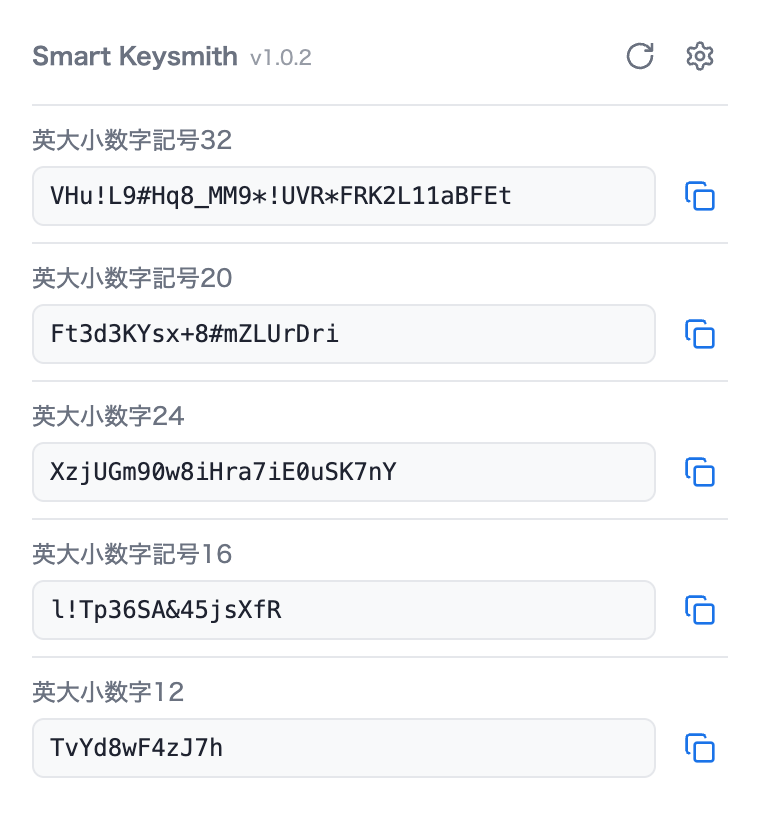
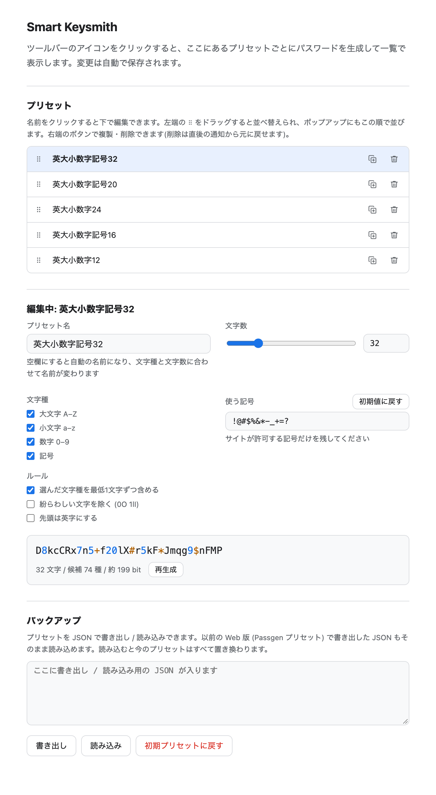

# Smart Keysmith

ツールバーのアイコンをクリックすると、**プリセットごとにランダムなパスワードを生成して一覧で表示**し、
横の **コピー** ボタン(重なった四角のアイコン)でクリップボードにコピーできる Chrome 拡張 (MV3)。



## なぜ作ったか

情報漏えいのニュースが続き、利用している Web サイトのパスワードを再設定し直す機会が増えました。
ところが、使える記号や文字数の上限などのルールはサイトごとに違います。既存のパスワードジェネレーターでは、
そのたびに文字数や文字種の設定を変えて生成し、コピーし直す必要があり、これが煩わしいものでした。

Smart Keysmith では、よく使うルールをプリセットとして登録しておけば、アイコンを開くだけで
プリセットごとのパスワードがすでに並んでいます。サイトのルールに合うものを選んでコピーするだけで済みます。

## 主な機能

- ポップアップを開くたびに新しいパスワードを生成します。右上の丸い矢印(すべて再生成)で作り直せます
- コピーするとボタンが 1.5 秒だけ緑のチェックになります
- 33 文字以上のパスワードは先頭 32 文字 + 「…」で表示します(コピーは全文)
- **オプション画面**(ポップアップ右上の歯車)でプリセットを追加・編集・並べ替え(ドラッグ)できます。
  ポップアップにはこの順で並びます。文字数・文字種・使う記号・ルールを変えられ、
  生成例と強さ (bit) もその場で確認できます。使う記号は「初期値に戻す」ボタンで初期プリセットの記号に戻せます
- 以前の Web 版 (Passgen プリセット) で書き出した JSON を、オプション画面からそのまま読み込めます
- `chrome://extensions/shortcuts` でポップアップを開くキーボードショートカットを割り当てられます
- 乱数は `crypto.getRandomValues`(偏りなし)。生成したパスワードは保存も送信もしません

## オプション画面



## 初期プリセット

名前を付けていないプリセットは、選んだ文字種と文字数から自動で名前が付きます
(オプション画面で名前を入れればそちらが優先)。初期プリセットはすべて自動の名前です。

| 表示される名前 | 使う記号 | ルール |
| --- | --- | --- |
| 英大小数字記号32(既定) | `!@#$%&*-_+=?` | 各文字種を最低1文字 |
| 英大小数字記号20 | `!@#$%&*-_+=?` | 各文字種を最低1文字 |
| 英大小数字24 | — | 各文字種を最低1文字 |
| 英大小数字記号16 | `!@#$%&*-_` | 各文字種を最低1文字、先頭は英字 |
| 英大小数字12 | — | 各文字種を最低1文字、先頭は英字、`0O1lI` を除く |

「英大小」は英字の大文字と小文字の両方、「英大」「英小」はどちらか片方だけを選んだときの表示です。

## インストール

1. `chrome://extensions` を開く
2. 右上の「デベロッパーモード」をオン
3. 「パッケージ化されていない拡張機能を読み込む」でこのディレクトリを選ぶ
4. ツールバーのパズルアイコンから Smart Keysmith をピン留めする

## テスト

```sh
node --test test/
```
